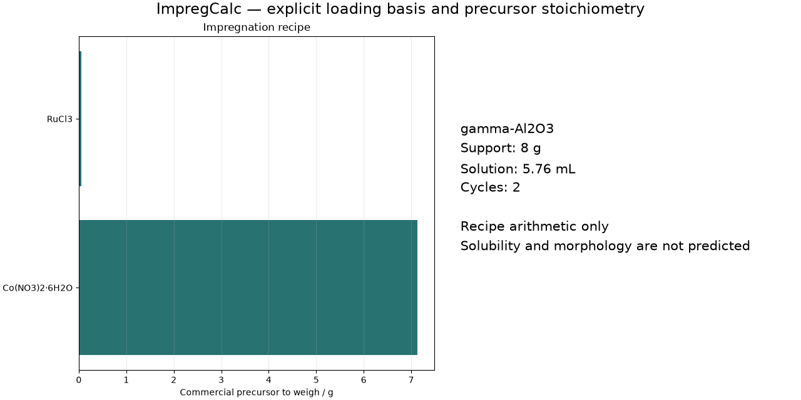

# ImpregCalc

**Explicit, mass-conserving recipes for supported-catalyst impregnation.**

[](https://github.com/hdkim99/ImpregCalc/actions/workflows/ci.yml)
[](https://github.com/hdkim99/ImpregCalc/actions/workflows/macos.yml)
[](LICENSE)
[](pyproject.toml)



ImpregCalc answers a narrow laboratory question: **what mass of each specified
precursor should I weigh, and what nominal liquid volume follows from my explicitly
chosen loading convention?** It keeps elemental-metal, metal-oxide, and precursor
loadings separate; it also keeps final-catalyst and support-relative denominators
separate.

## Why

`15 wt% Co`, `15 wt% Co3O4`, and `15 wt% cobalt nitrate` are different recipes.
Hydrate state and assay/purity change the mass to weigh. A promoter atomic ratio
couples to the main component mass. ImpregCalc records these choices in the input
and in every exported result instead of silently guessing them.

## Install

ImpregCalc is currently source-installable while the first PyPI release is prepared:

```bash
git clone https://github.com/hdkim99/ImpregCalc.git
cd ImpregCalc
python3 -m venv .venv
source .venv/bin/activate
python -m pip install .
```

XLSX and publication-figure export are optional:

```bash
python -m pip install ".[xlsx,plot]"
```

The GUI uses Python's Tkinter/ttk. On macOS, use a Python distribution built with
Tcl/Tk support. `python -c "import tkinter"` should succeed.

## 30-second example

The included example specifies 15 wt% elemental Co on a final-formulated-catalyst
basis, a Ru:Co atomic ratio of 0.01, hydrated cobalt nitrate at 98% assay, 8 g of
support, and two arithmetic impregnation cycles:

```bash
impregcalc validate examples/co_ru_iwi.json
impregcalc calculate examples/co_ru_iwi.json --output recipe.md
impregcalc calculate examples/co_ru_iwi.json --output recipe.xlsx
impregcalc calculate examples/co_ru_iwi.json --plot recipe.svg
```

The same core is available from Python:

```python
from impregcalc import calculate_recipe

result = calculate_recipe("examples/co_ru_iwi.json")
print(result.requirements[0].commercial_precursor_mass_g)
print(result.mass_closure_residual_g)
```

## GUI

```bash
python -m impregcalc.gui
# or: impregcalc-gui
```

The main GUI workflow performs a real single-target calculation, displays the full
recipe and assumptions, and exports Markdown, JSON, CSV, or XLSX. Co-impregnation
and promoter-ratio workflows are available through JSON, CLI, and Python API in
0.1.0; the compact GUI does not yet provide multi-target editors.

Tkinter is intentionally used instead of Qt. The core and CLI do not import Tkinter,
matplotlib, PyQt, or PySide. Result figures use the explicit non-interactive `Agg`
backend and are exported as PNG, SVG, or PDF.

## Scientific basis

- Hydrate-dot formulas such as `Co(NO3)2·6H2O`, `Ni(NO3)2·6H2O`,
  `Fe(NO3)3·9H2O`, and `Cu(NO3)2·3H2O` are parsed into integer elemental counts.
- Coupled final-basis and support-relative loadings are solved from one component
  mass balance.
- Oxide targets use the specified oxide stoichiometry; purity scales the commercial
  precursor mass, not the requested active-component mass.
- Promoters may be specified by an elemental atomic ratio to a named main target.
- IWI nominal volume is `dry support mass × supplied pore volume`. It is reported as
  a planning value, not as a universal wetting truth.

Equations, derivations, atomic-weight policy, and peer-reviewed references are in
[`docs/scientific-basis.md`](docs/scientific-basis.md).

## Validation

The test suite covers hand-calculated elemental and oxide loadings, hydrated
precursors, purity, co-impregnation, atomic-ratio promoters, mass closure, nominal
IWI volume, wet impregnation, cycle splits, invalid compositions, exports, CLI/core
import isolation, and GUI calculation/export/close lifecycle. See
[`docs/validation.md`](docs/validation.md).

Published-method arithmetic regressions cover support-relative Fe from nitrate
nonahydrate (IC-PUB-002), final-basis Nb2O5 from NbCl5 with nominal/ICP values kept
separate (IC-PUB-003), and coupled final-basis Co/Pt co-impregnation (IC-PUB-004).
A Pd(acac)2 paper with an unspecified denominator is reported as a two-convention
definition audit, not forced into a gold case. This validates recipe arithmetic, not
laboratory reproducibility, precursor retention, morphology, or catalytic behavior.

## Scope and limitations

ImpregCalc is recipe arithmetic, not a catalyst-structure simulator. Version 0.1.0:

- supports IWI and wet-impregnation liquid planning;
- does not calculate precipitation, sol-gel, hydrothermal, or deposition kinetics;
- does not contain an asserted solubility database or declare a recipe feasible or
  impossible from concentration alone;
- does not predict pore filling, adsorption, drying redistribution, calcination
  loss, phase formation, dispersion, morphology, activity, or safety;
- treats multi-cycle preparation as an arithmetic allocation only;
- rejects charges, variable hydrate states (`xH2O`), fractional stoichiometry, and
  isotopically enriched formulas rather than guessing them.

## Supported platforms

- Python: 3.10–3.13 (3.14 is locally smoke-tested but not yet in the supported range)
- macOS CI: macOS 15 on Apple Silicon and Intel, Python 3.10 and 3.13
- local macOS validation: macOS 27.0, Apple Silicon, Python 3.14.7, Tk 9.0
- scientific CI: Linux ARM64 DGX self-hosted runner
- GUI: Tkinter/ttk; no Qt dependency

See [`docs/macos.md`](docs/macos.md) for the support matrix and diagnostic commands.

## Development

```bash
python -m pip install -e ".[dev,plot]"
ruff format --check .
ruff check .
mypy src
pytest
python -m build
twine check dist/*
```

Scientific contributions must state the definition, units, assumptions, reference,
and a numerical regression case. See [CONTRIBUTING.md](CONTRIBUTING.md).
